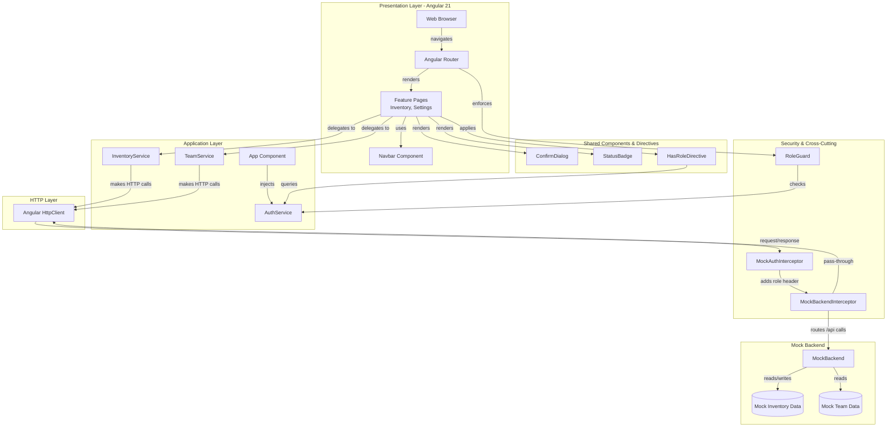
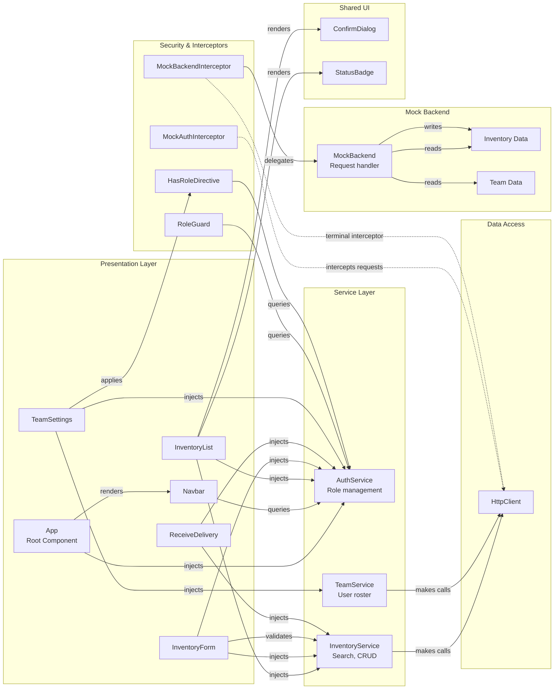

# Architecture Diagram

ShelfGuard is an Angular 21 inventory management application with a layered architecture featuring services, interceptors, and a mock backend for development. The application uses signals-based state management and standalone components with feature-based organization.

## Application Architecture

<!-- mermaid-checked: no \n, no em-dash/en-dash, no {} in labels, subgraphs are id["label"], arrows are -->|"label"|, all subgraphs closed by end, ids unique -->

### Technology Stack Summary

| Layer | Technology | Version | Purpose |
|-------|-----------|---------|---------|
| **Client** | Angular | 21.2.0 | Standalone components, signals-based reactivity |
| **UI Framework** | Angular Material | 21.2.14 | Material Design components and themes |
| **Routing** | Angular Router | 21.2.0 | Client-side navigation and guards |
| **HTTP** | Angular HttpClient | 21.2.0 | HTTP communication with interceptor chain |
| **State** | Angular Signals | 21.2.0 | Reactive state management (AuthService) |
| **Forms** | Angular Forms | 21.2.0 | Reactive forms validation |
| **Dev/Test** | Vitest | 4.0.8 | Unit testing framework |

### Data Storage & External Services

The application uses a **mock backend** for development and testing. The MockBackend service intercepts all HTTP requests to `/api/*` and returns synthetic data without making real network calls. Data is stored in memory within two seed datasets: **Mock Inventory Data** (product catalog with stock levels, SKU codes, and status) and **Mock Team Data** (user roster). The MockBackendInterceptor acts as a terminal interceptor, preventing real HTTP requests from leaving the browser. This design enables offline development and deterministic testing without external API dependencies.

### Key Architectural Decisions

- **Signals-Based Reactivity**: AuthService uses Angular Signals for fine-grained, synchronous state management, triggering effects in the root App component when role changes occur.
- **Interceptor Chain**: Two interceptors work together—MockAuthInterceptor adds user role headers for authorization checks, while MockBackendInterceptor acts as a terminal handler for all `/api/*` calls, eliminating the need for a real backend during development.
- **Standalone Components**: All Angular components use the standalone API (no NgModules), reducing boilerplate and simplifying dependency injection via constructor parameters.
- **Role-Based Access Control**: RoleGuard enforces role checks at route level; RoleDirective conditionally renders UI elements based on the current user's role (Admin vs. Viewer).

---

## Component Relationships

<!-- mermaid-checked: no \n, no em-dash/en-dash, no {} in labels, subgraphs are id["label"], arrows are -->|"label"|, all subgraphs closed by end, ids unique -->

### Component Inventory

| Component | Layer | Type | Responsibility |
|-----------|-------|------|-----------------|
| **App** | Presentation | Root Component | Bootstrap; react to auth changes with route reload |
| **InventoryList** | Presentation | Feature Component | Display inventory items with search and filters; trigger actions |
| **InventoryForm** | Presentation | Feature Component | Create/edit inventory items; validate SKU uniqueness |
| **ReceiveDelivery** | Presentation | Feature Component | Record inbound stock and update quantities |
| **TeamSettings** | Presentation | Feature Component | Manage user roles and permissions (Admin only) |
| **Navbar** | Shared | Component | Display user role and navigation links |
| **ConfirmDialog** | Shared | Component | Confirmation modal for destructive actions |
| **StatusBadge** | Shared | Component | Visual indicator for stock status (OK, Low, Out) |
| **AuthService** | Service | Singleton Service | Manage current user role; provide reactive role signal |
| **InventoryService** | Service | Singleton Service | Search items; create/update/delete; check SKU uniqueness |
| **TeamService** | Service | Singleton Service | Fetch and manage user roster |
| **RoleGuard** | Security | Route Guard | Enforce role-based route access |
| **HasRoleDirective** | Security | Structural Directive | Conditionally render elements based on user role |
| **MockAuthInterceptor** | Security | HTTP Interceptor | Add X-User-Role header to all requests for backend authorization |
| **MockBackendInterceptor** | Security | HTTP Interceptor | Terminal interceptor; intercept `/api/*` and delegate to MockBackend |
| **MockBackend** | Backend | Service | Simulate REST API; manage in-memory inventory and team data |
| **HttpClient** | Data Access | Angular Service | Execute HTTP requests (intercepted by security chain) |
