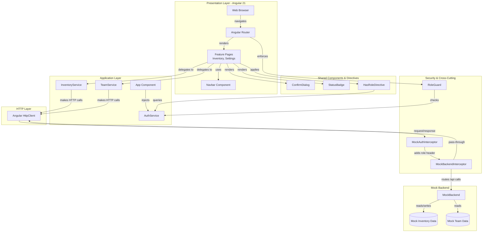
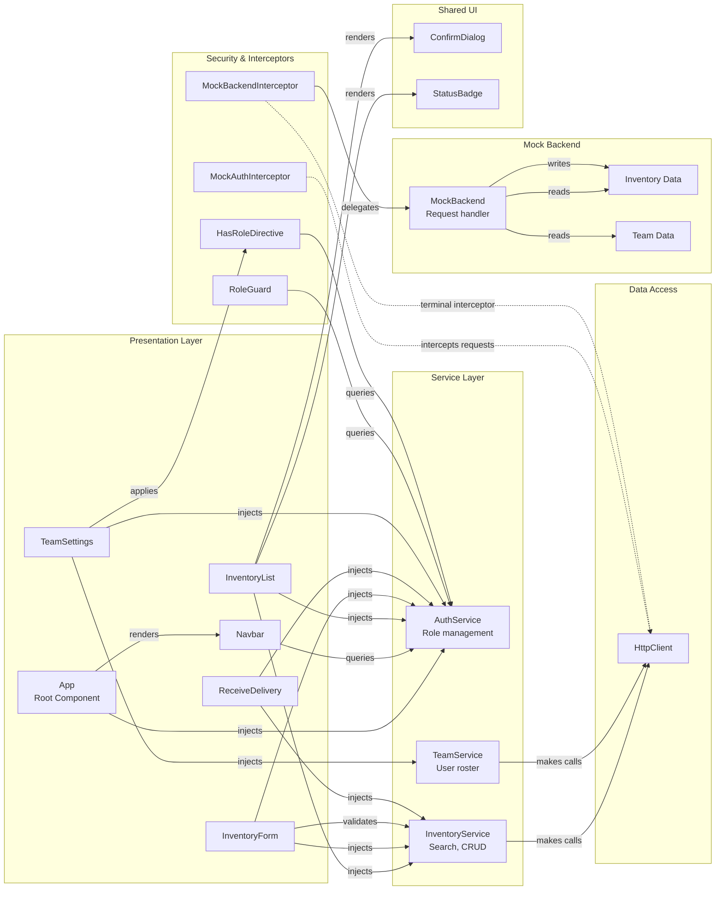

# ShelfGuard

A mini warehouse and team-access dashboard built with Angular 21 (standalone components, Signals, strict TypeScript) and Angular Material. All data is in memory and resets on reload: no backend, no login.

## Run

```bash
npm install
npm start        # http://localhost:4200
npm test         # unit tests (Vitest)
npm run build    # production build
```

Requires Node.js 20+ and the Angular CLI (`npm i -g @angular/cli`) if you want to use `ng` directly.

## Features

- **Role switcher** in the toolbar (Admin / Viewer). Switching updates the whole app instantly.
- **Inventory** (`/inventory`): 18 seeded items, search by name or SKU (debounced), status filter, status chips, and an Admin-only delete with confirmation dialog and snackbar.
- **Add item** (`/inventory/new`): reactive form with an async "SKU already exists" check, a dynamic suppliers list (at least one required), and a snackbar on success.
- **Receive delivery** (`/inventory/:id/receive`): a truck icon on each row opens a form to add a received quantity to an existing item, with a live preview of the new stock level. Open to Admins and Viewers.
- **Settings** (`/settings`): lazy-loaded team table, protected by a functional `roleGuard`. Viewers are redirected to `/inventory` with a warning.

## Assumptions

- Default role is Admin. Viewers can view and add items, but cannot delete or open settings.
- Low-stock threshold is 10 (`LOW_STOCK_THRESHOLD`). SKU format is `ABC-12345`.
- Services use `HttpClient` against `/api/*`. No real request is sent: `mockBackendInterceptor` answers from in-memory data after a 300 ms delay, and `mockAuthInterceptor` adds an `X-User-Role` header and logs each request (method, URL, status, duration) to the browser console. The mock backend returns 403 when a non-Admin deletes.

## Architecture

ShelfGuard uses a layered architecture with Angular 21 standalone components, signals-based state management, and a mock backend for development.

### Application Architecture

<!-- mermaid-checked: no \n, no em-dash/en-dash, no {} in labels, subgraphs are id["label"], arrows are -->|"label"|, all subgraphs closed by end, ids unique -->


#### Technology Stack

| Layer | Technology | Version | Purpose |
|-------|-----------|---------|---------|
| **Client** | Angular | 21.2.0 | Standalone components, signals-based reactivity |
| **UI Framework** | Angular Material | 21.2.14 | Material Design components and themes |
| **Routing** | Angular Router | 21.2.0 | Client-side navigation and guards |
| **HTTP** | Angular HttpClient | 21.2.0 | HTTP communication with interceptor chain |
| **State** | Angular Signals | 21.2.0 | Reactive state management (AuthService) |
| **Forms** | Angular Forms | 21.2.0 | Reactive forms validation |
| **Dev/Test** | Vitest | 4.0.8 | Unit testing framework |

#### Key Design Patterns

- **Signals-Based Reactivity**: AuthService uses Angular Signals for fine-grained, synchronous state management, triggering effects in the root App component when role changes occur.
- **Interceptor Chain**: Two interceptors work together—MockAuthInterceptor adds user role headers for authorization checks, while MockBackendInterceptor acts as a terminal handler for all `/api/*` calls, eliminating the need for a real backend during development.
- **Standalone Components**: All Angular components use the standalone API (no NgModules), reducing boilerplate and simplifying dependency injection via constructor parameters.
- **Role-Based Access Control**: RoleGuard enforces role checks at route level; HasRoleDirective conditionally renders UI elements based on the current user's role (Admin vs. Viewer).

### Component Relationships

<!-- mermaid-checked: no \n, no em-dash/en-dash, no {} in labels, subgraphs are id["label"], arrows are -->|"label"|, all subgraphs closed by end, ids unique -->


#### Component Inventory

| Component | Layer | Type | Responsibility |
|-----------|-------|------|-----------------|
| **App** | Presentation | Root Component | Bootstrap; react to auth changes with route reload |
| **InventoryList** | Presentation | Feature Component | Display inventory items with search and filters; trigger actions |
| **InventoryForm** | Presentation | Feature Component | Create/edit inventory items; validate SKU uniqueness |
| **ReceiveDelivery** | Presentation | Feature Component | Record inbound stock and update quantities |
| **TeamSettings** | Presentation | Feature Component | Manage user roles and permissions (Admin only) |
| **Navbar** | Shared | Component | Display user role and navigation links |
| **ConfirmDialog** | Shared | Component | Confirmation modal for destructive actions |
| **StatusBadge** | Shared | Component | Visual indicator for stock status (OK, Low, Out) |
| **AuthService** | Service | Singleton Service | Manage current user role; provide reactive role signal |
| **InventoryService** | Service | Singleton Service | Search items; create/update/delete; check SKU uniqueness |
| **TeamService** | Service | Singleton Service | Fetch and manage user roster |
| **RoleGuard** | Security | Route Guard | Enforce role-based route access |
| **HasRoleDirective** | Security | Structural Directive | Conditionally render elements based on user role |
| **MockAuthInterceptor** | Security | HTTP Interceptor | Add X-User-Role header to all requests for backend authorization |
| **MockBackendInterceptor** | Security | HTTP Interceptor | Terminal interceptor; intercept `/api/*` and delegate to MockBackend |
| **MockBackend** | Backend | Service | Simulate REST API; manage in-memory inventory and team data |
| **HttpClient** | Data Access | Angular Service | Execute HTTP requests (intercepted by security chain) |

## Layout

```text
src/app/
  core/      models, mock data, services (auth, inventory, team), http interceptors, mock backend, role guard
  features/  inventory (list, form, receive-delivery), settings (team-settings)
  shared/    navbar (with role switcher), status-badge, confirm-dialog, has-role directive
```
