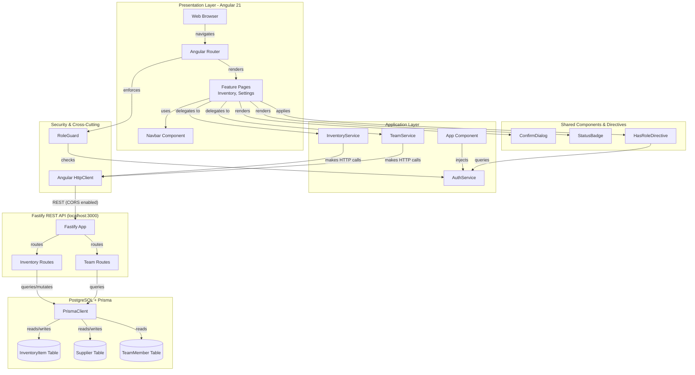
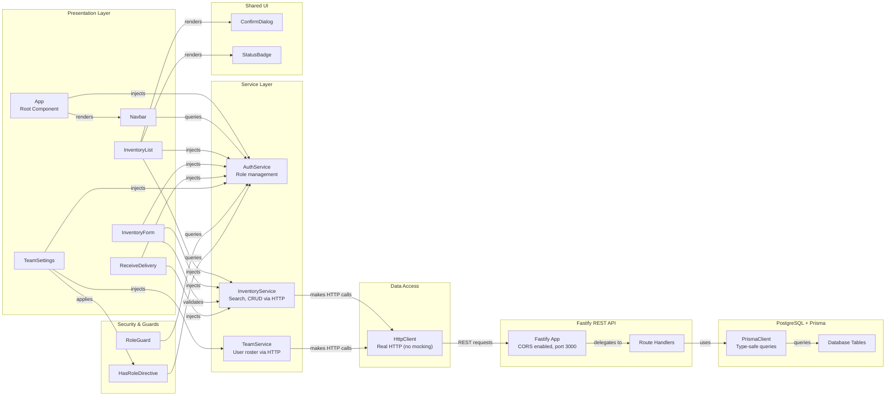

# ShelfGuard

A full-stack warehouse management dashboard built with Angular 21 (frontend) and Fastify (backend), powered by PostgreSQL and Prisma ORM. Data persists in production-grade database—no reset on reload.

## Run

```bash
npm install

# Terminal 1: Backend
npm run start:server    # http://localhost:3000

# Terminal 2: Frontend
npm start               # http://localhost:4201

# Testing & build
npm test                # unit tests (Vitest)
npm run build           # production build
```

**Requires Node.js 24+** and `.env.local` with `DATABASE_URL` set.

## Features

- **Role switcher** in toolbar (Admin / Viewer). Viewers can view and add items; Admins have full CRUD.
- **Inventory** (`/inventory`): search by name or SKU, status filter, Admin-only delete with confirmation.
- **Add item** (`/inventory/new`): reactive form with async "SKU already exists" check, suppliers list.
- **Receive delivery** (`/inventory/:id/receive`): add stock with live preview. Open to Admins and Viewers.
- **Settings** (`/settings`): team table, Admin only (redirects with warning for Viewers).
- **Database-first**: all changes persist to PostgreSQL via Prisma ORM. Real HTTP API, no mocking.

## Architecture

ShelfGuard uses a full-stack architecture: Angular frontend, Fastify backend, PostgreSQL database, Prisma type-safe ORM.

### Application Architecture

<!-- mermaid-checked: no \n, no em-dash/en-dash, no {} in labels, subgraphs are id["label"], arrows are -->|"label"|, all subgraphs closed by end, ids unique -->


#### Technology Stack

| Layer | Technology | Version | Purpose |
|-------|-----------|---------|---------|
| **Frontend** | Angular | 21.2.0 | Standalone components, signals-based reactivity |
| **UI Framework** | Angular Material | 21.2.14 | Material Design components and themes |
| **HTTP** | Angular HttpClient | 21.2.0 | HTTP communication with real backend API |
| **Backend** | Fastify | 5.12.8 | Fast, lightweight REST API server |
| **Database** | PostgreSQL | 17.2 | Prisma Cloud managed instance (db.prisma.io) |
| **ORM** | Prisma | 8.0.0 | Type-safe database access with auto-generated client |
| **State** | Angular Signals | 21.2.0 | Reactive state management (AuthService) |
| **Forms** | Angular Forms | 21.2.0 | Reactive forms validation |
| **Dev/Test** | Vitest | 4.0.8 | Unit testing framework |

#### Key Design Patterns

- **Real Backend First**: Replaced mock interceptors with live Fastify REST API running on port 3000. All requests are real HTTP calls.
- **Type-Safe Database Access**: Prisma 8 generates a type-safe TypeScript client from the schema; all queries are type-checked at compile time.
- **Signals-Based Reactivity**: AuthService uses Angular Signals for fine-grained, synchronous state management, triggering effects when role changes occur.
- **Standalone Components**: All Angular components use the standalone API (no NgModules), reducing boilerplate and simplifying dependency injection.
- **Role-Based Access Control**: RoleGuard enforces role checks at route level; HasRoleDirective conditionally renders UI elements based on user role.
- **CORS-Enabled for Development**: Fastify configured with permissive CORS to allow frontend (localhost:4201) to call backend (localhost:3000).

### Database Schema

Three core tables managed by Prisma:

```
InventoryItem
  id: String (PK)
  name: String
  sku: String (unique)
  category: String
  stock: Int
  createdAt: DateTime
  updatedAt: DateTime
  suppliers: Supplier[] (relation)

Supplier
  id: String (PK)
  name: String
  leadTimeDays: Int
  inventoryItemId: String (FK)
  createdAt: DateTime
  updatedAt: DateTime
  inventoryItem: InventoryItem (relation)

TeamMember
  id: String (PK)
  name: String
  email: String
  role: String
  createdAt: DateTime
  updatedAt: DateTime
```

### REST API Endpoints

| Method | Endpoint | Description | Handler |
|--------|----------|-------------|---------|
| GET | `/api/inventory` | List all items | InventoryService → server.ts |
| GET | `/api/inventory/:id` | Get single item by ID | InventoryService → server.ts |
| GET | `/api/inventory/sku/:sku` | Check if SKU exists | InventoryService → server.ts |
| POST | `/api/inventory` | Create new item | InventoryService → server.ts |
| PUT | `/api/inventory/:id` | Update item | InventoryService → server.ts |
| DELETE | `/api/inventory/:id` | Delete item | InventoryService → server.ts |
| POST | `/api/inventory/:id/receive` | Add received stock | InventoryService → server.ts |

### Component Relationships

<!-- mermaid-checked: no \n, no em-dash/en-dash, no {} in labels, subgraphs are id["label"], arrows are -->|"label"|, all subgraphs closed by end, ids unique -->


#### Component Inventory

| Component | Layer | Type | Responsibility |
|-----------|-------|------|-----------------|
| **App** | Presentation | Root Component | Bootstrap; react to auth changes |
| **InventoryList** | Presentation | Feature Component | Display items with search, filters; trigger CRUD actions |
| **InventoryForm** | Presentation | Feature Component | Create/edit items; validate SKU uniqueness via API |
| **ReceiveDelivery** | Presentation | Feature Component | Record inbound stock; update quantities in database |
| **TeamSettings** | Presentation | Feature Component | Manage team (Admin only) |
| **Navbar** | Shared | Component | Display user role and navigation links |
| **ConfirmDialog** | Shared | Component | Confirmation modal for destructive actions |
| **StatusBadge** | Shared | Component | Visual indicator for stock status |
| **AuthService** | Service | Singleton Service | Manage current user role; provide reactive role signal |
| **InventoryService** | Service | Singleton Service | Search items; create/update/delete via REST API |
| **TeamService** | Service | Singleton Service | Fetch and manage user roster via REST API |
| **RoleGuard** | Security | Route Guard | Enforce role-based route access |
| **HasRoleDirective** | Security | Structural Directive | Conditionally render elements based on user role |
| **Fastify App** | Backend | Server | HTTP server with routing, CORS, error handling |
| **Route Handlers** | Backend | Controllers | Execute database operations via Prisma |
| **PrismaClient** | Data Access | ORM Client | Type-safe queries to PostgreSQL |
| **HttpClient** | Data Access | Angular Service | Execute HTTP requests (real, not mocked) |

## Layout

```text
src/app/
  core/      models, services (auth, inventory, team), guards
  features/  inventory (list, form, receive-delivery), settings (team-settings)
  shared/    navbar (with role switcher), status-badge, confirm-dialog, has-role directive

server/
  src/
    server.ts         Fastify app, 7 REST endpoints, CORS config

prisma/
  schema.prisma       Database schema (InventoryItem, Supplier, TeamMember)
  seed.ts             Seed script with 18 test items and 5 team members
```

## Development Workflow

1. **Backend**: `npm run start:server` starts Fastify on port 3000
2. **Frontend**: `npm start` starts Angular on port 4201
3. **Database**: Prisma Cloud PostgreSQL instance running at `db.prisma.io`
4. **API Calls**: InventoryService makes real HTTP requests to backend (no interceptors, no mocking)
5. **Data Flow**: Frontend → HTTP → Fastify → Prisma → PostgreSQL; changes persist across reloads

## Key Learnings & Notes

- **Prisma v8 Breaking Changes**: No `prisma studio` command; use DBeaver or direct API queries for database inspection.
- **Schema Field Names**: The actual schema uses `suppliers` (plural), `stock` (not quantity). API endpoints must match schema exactly.
- **Dotenv Configuration**: Must explicitly load `.env.local` with `dotenv.config({ path: '.env.local' })` in server.ts.
- **CORS for Development**: Currently permissive (`origin: true`); for production, restrict to known frontend URL.
- **Type Safety**: Prisma generates TypeScript types for all models; queries are compile-time checked.

